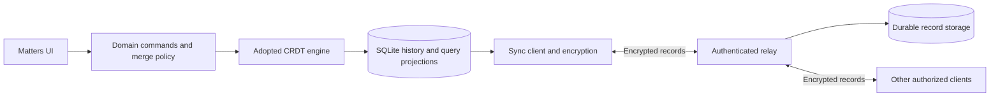

# Encrypted sync architecture and evaluation plan

**Date:** 2026-11-18

**Status:** Agreed product requirements; proposed architecture and dependency choices.

**Scope:** Matters as the first customer of an independently usable sync service.

Matters will retain local SQLite storage and offline operation while gaining post-quantum end-to-end encrypted synchronization. The client and service boundaries must support eventual use by other applications. Adopt existing CRDT and cryptographic implementations; build the application integration and service lifecycle around them.

The recommended evaluation starts with Loro for CRDT state, SQLite for local persistence and query projections, and an opaque relay for encrypted records. Select the cryptographic protocol before selecting its implementation. The alternatives and decision gates below precede infrastructure code. The decision records below select prototype candidates; production adoption and hosting remain separate decisions.

## Decision work in progress

- [ADR 0001: CRDT adoption](decisions/0001-crdt-adoption.md) proposes Loro 1.18.0, collection boundaries, task merge rules, the SQL write migration and reproducible prototype gates for [#32](https://github.com/thestephenromano/matters/issues/32).
- [ADR 0002: post-quantum protocol](decisions/0002-post-quantum-sync.md) proposes exact recipient-envelope/signature choices, authenticated messages, authority, recovery and adversarial checks for [#33](https://github.com/thestephenromano/matters/issues/33).
- [Dependency evidence](evidence/README.md) records the inspected versions, checksums and source limitations. The [prototype review record](../experiments/sync-prototype/REVIEW.md) maps semantic checks to their tests. [Refreshed measurement samples](../experiments/sync-prototype/evidence/review-2026-11-18.json) cover Loro/SQLite revision `49e969c` on `betelgeuse`; independent security review remains open.

- [Encrypted content-record contract](SYNC_RECORD_CONTRACT.md) defines the experimental canonical bytes, bounded codec, conformance fixtures and remaining admission/service obligations for #33/#34/#36.
- [Authenticated key-distribution experiment](SYNC_KEY_DISTRIBUTION.md) binds device keys, membership, writer admission and recipient envelopes to exact bytes, with a test-only two-device encrypted Loro round trip; durable lifecycle and outbox work remain open.
- [Encrypted-outbox experiment](SYNC_ENCRYPTED_OUTBOX.md) exercises durable reservations, exact-byte retries, process-crash boundaries, fresh local writers after restore and explicit recovery-required old-writer intents; authenticated receive/history admission and app integration remain open.

Both ADRs were approved for bounded prototype evaluation on 2026-11-18. They refine the options below; approval does not turn planned security properties into demonstrated behavior.

## Agreed product requirements

- Core task operations work without a network connection or service account.
- Content is encrypted on clients before upload. The service does not possess content decryption keys.
- Post-quantum protection covers content-key distribution, device authorization and recovery, as well as stored updates and snapshots. Transport encryption is an additional layer.
- The service has no knowledge of tasks, projects, GTD views or their merge policies. Managed hosting and self-hosting use the same client contract.
- Start with Matters, one CRDT engine and a native Rust client. Validate a second application before expanding SDK and engine coverage.
- Security and durability claims require evidence tied to the shipped versions, configuration and threat model.

The commercial hypothesis is that developers will pay for dependable encrypted sync, device recovery and operations. Willingness to pay and service economics remain to be tested. Peer-to-peer transport remains a future option; the proposed first deployment uses a relay so devices need not be online together.

## Security contract

### Assets and trust boundaries

Protect task content, CRDT history, snapshots, content keys, device private keys and recovery material. Treat the network and service operator as untrusted for content confidentiality and integrity. The operator can observe metadata and can withhold, reorder, replay or delete records. An authorized device may also submit malformed or malicious input.

Trust an uncompromised client, its operating system, random-number source and selected cryptographic implementation. A compromised unlocked endpoint can read its available data. End-to-end encryption does not encrypt the current plaintext SQLite file, its WAL or local backups; local storage protection needs its own decision before a broader device-at-rest claim.

The quantum threat includes recording ciphertext and key exchanges now for later cryptanalysis. Long-lived content keys must have no classical-only distribution or recovery route. Post-quantum authentication is also necessary to resist future impersonation of devices and membership authorities.

### Required properties and limits

| Property | Required behavior | Scope or limit |
| --- | --- | --- |
| Content confidentiality | Updates, snapshots and recovery bundles reach the service only as ciphertext. | Account identifiers, collection identifiers, sizes, timing, device counts, IP addresses and access patterns remain observable. |
| Content integrity | Clients authenticate the envelope, author and authorization before applying an update. | A shared content key alone does not prove which member authored a change. Authorized writers can still write unwanted content. |
| Context binding | Authentication binds application/tenant context, collection, record identity, key epoch, author, format and suite version. | A record copied into another context must fail verification. |
| Replay and ordering | Duplicate delivery is harmless; missing causal dependencies are retained and fetched. | CRDT convergence does not establish authenticity, completeness or freshness. |
| Rollback and fork detection | Clients retain authenticated checkpoints and reject contradictions with previously accepted state. | A fresh or isolated client cannot establish global freshness from an adversarial server alone. It needs an independent checkpoint or trusted peer; the service cannot promise universal fork detection. |
| Membership | Only an authenticated membership authority can enroll devices or change roles. | A server account reset or substituted public key must not grant decryption access. |
| Availability and durability | Retry, restore and acknowledgement behavior are explicit and testable. | Encryption cannot prevent a malicious operator from withholding or destroying all server copies. |

Record parsing, signature checking, decompression and CRDT import need resource limits. Derive those limits from measured workloads and adversarial tests rather than embedding unexplained constants. Operational logs must exclude plaintext, secrets and decrypted document structure.

## Cryptographic adoption choices

NIST has finalized [ML-KEM in FIPS 203](https://csrc.nist.gov/pubs/fips/203/final) for key establishment and [ML-DSA in FIPS 204](https://csrc.nist.gov/pubs/fips/204/final) for signatures. These are primitives, not a complete device-sharing or recovery protocol. Track the standards' errata when pinning implementations.

| Responsibility | Recommended evaluation | Selection condition |
| --- | --- | --- |
| Payload encryption | AES-256-GCM, an authenticated-encryption construction specified by [SP 800-38D](https://csrc.nist.gov/pubs/sp/800/38/d/final). | Specify key derivation, authenticated context, nonce uniqueness, per-key usage budgets and crash/restore behavior. |
| Key distribution | An established ML-KEM-based construction, preferably a reviewed post-quantum/traditional hybrid. | Pin its exact specification, parameter sets, encoding, authentication and implementation. Do not invent a combiner. |
| Identity and authorization | ML-DSA-based signatures where independent authorship or membership authorization is required. | Specify the complete trust chain, signed bytes, replay rules, key rotation and batching policy. |
| Protocol composition | Evaluate [HPKE](https://www.rfc-editor.org/rfc/rfc9180.html) for recipient envelopes and [MLS](https://www.rfc-editor.org/rfc/rfc9420.html) for group lifecycle. | Neither name alone establishes a suitable post-quantum suite. Check asynchronous enrollment, retained history, offline devices and available implementations. |

HPKE's word “hybrid” refers to public-key and symmetric encryption; it does not itself mean a post-quantum/traditional hybrid. RFC 9180's original suites are insufficient to establish our post-quantum requirement. MLS supplies an established group-key design, but historical document access and offline membership transitions still need an application policy.

Two Rust implementation candidates deserve evaluation:

- [libcrux](https://github.com/celabshq/libcrux) includes ML-KEM, ML-DSA, hybrid KEMs and AEAD implementations. Its documentation identifies pre-release status and differing verification coverage by component, with explicit limits on executable side-channel and secret-zeroization assurances. Inspect the selected release and feature set; do not transfer a library-level verification claim to the whole service.
- [aws-lc-rs](https://github.com/aws/aws-lc-rs) provides Rust APIs over AWS-LC, including an [ML-KEM API](https://docs.rs/aws-lc-rs/latest/aws_lc_rs/kem/index.html). Evaluate supported algorithms, targets, packaging and maintenance for the chosen protocol. Primitive availability is not evidence of a complete compatible envelope implementation.

[OpenMLS](https://github.com/openmls/openmls) is a Rust MLS implementation, but the suites listed in its current README use classical public-key algorithms. It is a group-lifecycle comparison point, not an accepted post-quantum solution.

Select one versioned suite initially. Authenticate suite/version identifiers and reject unsupported or downgraded formats. Migration must never silently fall back to classical-only protection. Rewrapping keys later cannot repair exposure of previously recorded weak key envelopes. Independent review of the selected composition is a production gate; algorithm conformance or a validated dependency does not certify the application.

## Proposed key lifecycle

Separate service login credentials, device identity/signing keys, device key-establishment keys and collection content keys. A collection is a unit of authorization and encryption, not necessarily one CRDT document. The initial scope is one person's devices; the boundary permits later sharing without implementing team roles now.

| Event | Proposed behavior |
| --- | --- |
| First device | Generate keys locally with the OS random source. Establish the collection membership authority and initial content-key epoch. Keep private keys out of service storage except in client-encrypted recovery material. |
| New device | Verify the new device's keys through an existing authorized device or recovery authority, using an authenticated out-of-band binding. Login alone cannot authorize enrollment. Distribute permitted content keys through the selected post-quantum protocol. |
| Ordinary writes | Encrypt batches locally. Persist the exact outgoing record before sending; retries reuse those bytes. The protocol must prevent key/nonce reuse across devices, concurrency, crashes, restored backups and cloned installations. |
| Rotation | Publish an authenticated epoch transition and distribute fresh content keys to retained members. Keep historical decryption material only according to the explicit history policy. Rotation alone does not establish forward secrecy or post-compromise security. |
| Device revocation | Advance membership and key epochs. The service rejects uploads from revoked devices; clients that know the transition reject unauthorized records even if the server serves them. Retained devices refresh membership before uploading an offline backlog. |
| Stale offline device | Keep local work. A still-authorized device verifies transitions and republishes eligible pending work under the current policy. An old-epoch record's claimed timestamp cannot prove it predates revocation; ambiguous writes require an explicit recovery path. |
| Recovery | Prefer enrollment from an existing device. For loss of all devices, evaluate a client-generated high-entropy recovery secret protecting an encrypted recovery bundle. Account-password reset cannot decrypt it. Define authority recovery and history-key access together. |
| Lost recovery material | If no authorized device or usable recovery secret remains, encrypted content is unrecoverable. Do not add a server-held bypass. |
| Restored or cloned client | Retain unsent edits, but establish a fresh writer identity and safe encryption state before new writes. Do not resume old counters or assume a copied installation is a distinct replica. |

Revocation protects new epochs only after a writer learns the transition. A disconnected device cannot know it has been revoked, and recipients cannot erase previously received keys or plaintext. The protocol must distinguish possession of old keys from permission to contribute new state.

Proposed initial history policy: a newly authorized personal device receives retained history; removal does not revoke its past knowledge. Recovery material must be updated as epochs change and restore-tested. Whether recovery can also change membership, and how competing membership transitions are ordered, must be resolved by the protocol selection. Membership is not an unrestricted CRDT merge.

## Proposed client and service boundaries

- **Matters domain:** maps user intent to CRDT operations and defines task semantics. Existing query behavior remains the reference for materialized views.
- **CRDT adapter:** owns engine-specific import/export, causal dependencies, document identities and migrations. The initial adapter is concrete; multiple-engine support is deferred.
- **Local persistence:** stores authoritative CRDT bytes, pending incoming records, outgoing records and rebuildable SQL projections. Local durable-save acknowledgement follows the SQLite commit. Failed commits must not leave the UI using an unpersisted authoritative CRDT state.
- **Sync client:** owns retries, checkpoints, cryptographic verification, epochs and transport adapters. It has no task-specific operations.
- **Service:** enforces tenant/collection access, stores opaque records and serves missing ranges/checkpoints. It owns quotas and operational restore procedures, but cannot validate task semantics or decrypt snapshots.

For imported records, retain original bytes while causal dependencies are missing. Loro explicitly documents that ordinary snapshots omit pending imports, so a successful import call or snapshot export alone is not sufficient persistence evidence. [Persistence behavior](https://loro.dev/docs/tutorial/persistence)

An upload acknowledgement must distinguish transient receipt from a durable commit. Publishing a notification must follow durable storage. Uploads need idempotency; the same record identity with different bytes must be rejected. Define the acknowledged failure domain, backup recovery point and restore behavior before promising a durability level. Storage choice follows that contract.

## CRDT and transport evaluation

| Candidate | Established capability | Fit and recommendation |
| --- | --- | --- |
| [Loro](https://github.com/loro-dev/loro) | Rust CRDTs, including text, movable lists and trees; snapshot/update persistence. | First candidate for task ordering and a native client. Validate domain semantics, memory, history growth and persistence before adoption. |
| [Automerge](https://automerge.org/docs/reference/concepts/) | Document CRDTs, a binary storage format and transport-independent sync. | Main alternative if Loro's semantics or lifecycle fail the evaluation. Check the actual Rust integration rather than assuming JavaScript repository APIs apply. |
| [SQLite-Sync](https://github.com/sqliteai/sqlite-sync) | SQLite CRDT extension with managed/backend integration. | SQL-first comparison. Require evidence that the intended encrypted deployment keeps content keys and plaintext out of the service; native integration alone is insufficient. |
| [Loro Protocol](https://loro.dev/blog/loro-protocol) | Multiplexed WebSocket rooms with Rust and TypeScript implementations. | Evaluate transport reuse. Its E2EE mode is explicitly experimental, with changeable wire/key APIs; it does not satisfy our production security contract by default. |

Recommend adopting a CRDT engine and established transport/crypto components, then building only missing application and service integration. Document an applicability failure before replacing an existing protocol, codec, queue or storage implementation. Use the local SQLite transaction for the outgoing queue; no separate message broker is justified by the initial workload.

Before dependency selection, record exact versions/revisions, licenses, supported targets, release status and relevant security evidence. The [Loro/SQLite measurement artifact](../experiments/sync-prototype/evidence/review-2026-11-18.json) records three 1,000-task comparisons at revision `49e969c` on `betelgeuse` (Intel i9-10920X, NVMe/Btrfs). Those samples cover that persistence prototype revision, not the encrypted-record codec or later heads. The alternatives and larger acceptance workloads remain unmeasured.

## Matters semantics and migration

The existing [schema](../crates/matters-core/src/storage/schema.rs) has foreign-key cascades, unique tag names and floating-point ordering. Its [write boundary](../crates/matters-core/src/storage/db.rs) accepts whole entities and exposes a raw connection. A CRDT integration must capture intentional changes without treating every stale field in an entity as a fresh edit. Audit all write paths before enabling sync.

The following are proposed acceptance cases, not changes to current behavior:

| Concurrent actions | Required result or decision |
| --- | --- |
| Edit title on one device and deadline on another | Preserve both intentional edits. |
| Edit notes on both devices | Merge through the engine's text type; retain recoverable history for surprising outcomes. |
| Complete and reopen the same task | Select and document a deterministic policy; keep status and completion timestamp consistent. |
| Move and reorder a task on different devices | One logical task in one valid location with stable order. Choose container and position semantics together. |
| Trash a project while editing or moving a child | Specify visibility and restore behavior consistent with the product's trash model. Local foreign-key cascades are not a distributed policy. |
| Empty Trash while an old device edits a deleted task | Prevent silent resurrection. Retain deletion evidence until the supported offline/history policy permits collection. |
| Independently create identically named tags | Preserve references and apply a deterministic identity/name policy without violating the SQL projection. |
| Create entities under the same UUID on two devices (duplicate import or faulty writer) | Keep both: the smaller engine node ID keeps the UUID and the other becomes a visible conflict copy with a derived identity ([ADR 0001](decisions/0001-crdt-adoption.md) C18). |

Choose document boundaries using these cases. Splitting every task into a document may complicate ordering and parent transitions; one document for the entire account may complicate selective sharing and loading. Measure both against realistic data before fixing the boundary.

The migration must preserve existing IDs and view results, back up the local database, and establish one initial CRDT lineage before enrolling other replicas. Independently importing identical SQL rows on each device can create unrelated CRDT identities. Keep the existing database recoverable until round-trip import, projection rebuild and restart checks pass.

## Checkpoints and retention

Only clients can create and semantically validate encrypted snapshots. A signature identifies a snapshot author; it does not prove the snapshot covers every acknowledged update. Checkpoint publication must bind the included records and CRDT causal frontier, preserve concurrent tail records and permit client verification against retained history.

For the first prototype, retain original updates, pending imports and full-history checkpoints. Defer destructive compaction and enforce explicit storage quotas rather than silently deleting history. Measure bytes per edit, bootstrap cost and storage growth to choose a retention budget.

Before production history pruning, specify which clients must acknowledge a checkpoint, how stale devices with unsent edits recover, and how deletion evidence survives. Do not assume a shallow snapshot can merge arbitrary old histories. An unsupported stale history must be preserved for export or explicit recovery, never silently discarded. [Loro export modes](https://loro.dev/docs/tutorial/encoding)

Server backups include ciphertext, membership records, envelopes and storage indexes. A restore must preserve consistent record identities and epochs. Test restore together with client retries and retained local checkpoints; availability recovery must not reset cryptographic state or silently roll clients backward.

## Evaluation stages and acceptance evidence

| Stage | Deliverable | Exit evidence |
| --- | --- | --- |
| 1. Adoption decision | Select the CRDT candidate and document boundaries to evaluate. Select the exact cryptographic protocol/suite before stage 3. | Written applicability comparison, version/license record and approval of the relevant component choices before infrastructure code. The cryptographic choice must cover the key lifecycle above. |
| 2. Local CRDT prototype | Two independent SQLite-backed clients using synthetic Matters data, with recorded delivery schedules. | Domain cases above converge; duplicates, missing dependencies, reordering, restart and projection rebuild preserve intended state. |
| 3. Encrypted relay prototype | Chosen protocol, durable records, enrollment, epoch transitions and recovery. | Reject tampering, cross-collection substitution, downgrade, forged authorship and revoked writes. Exercise cloned/restored state and retry idempotency; inspect server/log artifacts for content or keys. |
| 4. Matters integration | Migrate a copy of an existing database and connect the UI through the domain boundary. | Existing domain tests pass; local writes remain offline; crash injection at persistence boundaries and restore tests preserve saved edits. |
| 5. Hosted pilot | Operate managed and self-hosted deployments under the same contract. | Independent security review, backup restoration, tenant isolation, measured resource costs and a second application using the client without task-domain changes. |

For each experiment, retain source revisions, configuration, host/target, workload, deterministic failure schedules and results. Measure local commit latency, startup, catch-up after long disconnection, projection rebuild, encryption overhead and stored bytes per active collection. Set performance and retention budgets from those measurements.

Public claims must name the demonstrated scope. Until the relevant gates pass, describe post-quantum encrypted synchronization as planned work. The immediate decision is approval of the component evaluation choices, not a promise that an engine or cryptographic primitive already supplies the complete service.
